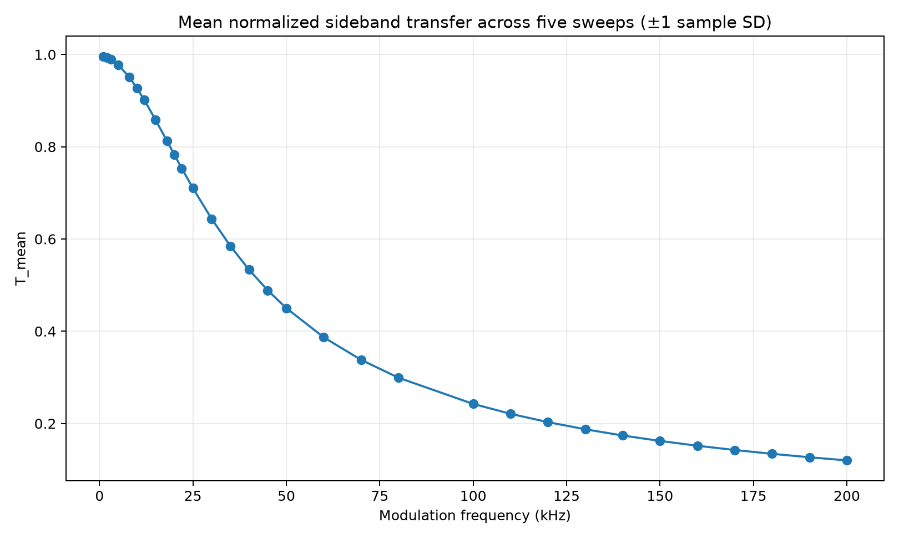
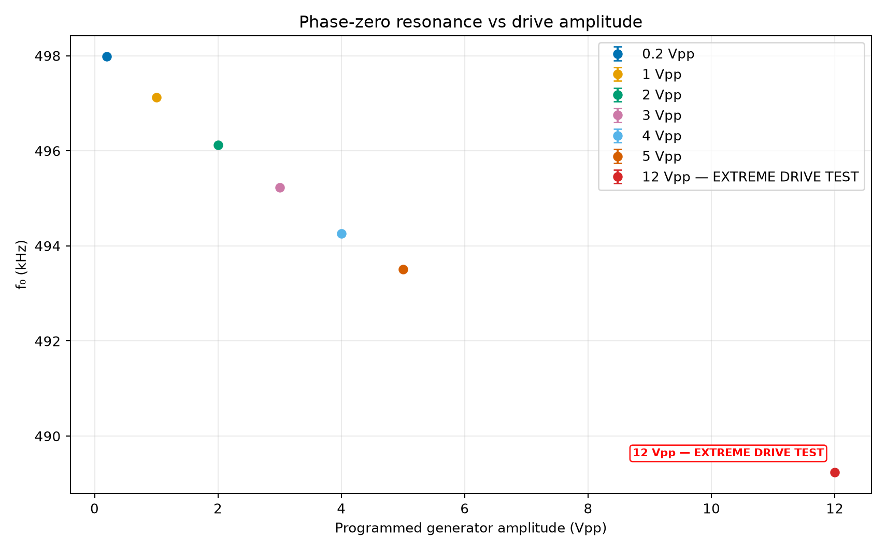

# RLC AM Measurements and Analysis

[English](#english) | [中文](#中文)

## English

Measured features, offline analysis scripts, figures, and Siglent acquisition scripts for a series RLC circuit. This project investigates AM sideband transfer relative to the carrier and the effect of drive amplitude on resonance.

The repository contains sanitized per-acquisition features and summary tables. Native oscilloscope waveforms remain local and are not published. The public CSV files support reproducing statistics and plots; they do not support rerunning the original FFT without the waveforms.



### Quick start: offline analysis

The verified environment is **CPython 3.13.7 on Windows x64**. Use Python 3.13 with a dedicated virtual environment. Offline analysis requires no instruments, VISA drivers, or network services.

From the repository root, in Windows PowerShell:

```powershell
py -3.13 -m venv .venv
.\.venv\Scripts\python.exe -m pip install -r requirements-lock.txt
.\.venv\Scripts\python.exe analysis/process.py
.\.venv\Scripts\python.exe tools/verify_release.py
```

Calling the virtual environment's Python directly requires neither activation nor a change to the PowerShell execution policy. Optional activation:

```powershell
.\.venv\Scripts\Activate.ps1
```

Equivalent commands for Linux / macOS:

```bash
python3.13 -m venv .venv
.venv/bin/python -m pip install -r requirements-lock.txt
.venv/bin/python analysis/process.py
.venv/bin/python tools/verify_release.py
```

Other platforms have not been tested on hardware; the dependency locks come from the Windows environment. `requirements.txt` lists direct dependencies, while `requirements-lock.txt` also pins transitive dependencies. The main libraries are NumPy, pandas, SciPy, and Matplotlib; see the requirements files for exact versions.

Results are written to the Git-ignored `outputs/` directory: summary tables and five plots for each AM batch, summary tables and four plots for each drive experiment, and `validation.json`. Archived inputs and existing figures remain in `data/` and `figures/`. The new entry point redraws these 18 plots; it does not automatically recreate the exact layouts of all 43 historical figures. See [VALIDATION.md](docs/VALIDATION.md) for validation evidence.

To process one batch or choose an output directory:

```powershell
.\.venv\Scripts\python.exe analysis/process.py --dataset am_extended
.\.venv\Scripts\python.exe analysis/process.py --dataset drive_extreme --output outputs/drive_check
```

### Measured data

| Data directory | Experiment date (UTC) | Conditions and records |
|---|---|---|
| `data/am_initial/` | 2026-09-26 | AM, 1–40 kHz; 15 modulation frequencies × 5 sweeps = 75 formal measurements, plus 5 end checks |
| `data/am_extended/` | 2026-09-30 | AM, 1–200 kHz; 31 modulation frequencies × 5 sweeps = 155 formal measurements, plus 5 end checks |
| `data/drive_support/` | 2026-10-01 | AM OFF; 0.2, 1, 2, 3, 4, and 5 Vpp, with 3 repeats each: 18 results |
| `data/drive_extreme/` | 2026-10-01 | AM OFF; the settings above plus 12 Vpp, with 3 repeats each: 21 results |
| `data/characterization/` | See individual run notes | Earlier resonance scans, amplitude sweeps, SNR screening, vertical-range calibration, and diagnostics |

Batches are stored and processed separately. Results collected on different dates or with different ranges or drive conditions must not be combined as a single experiment. `20260930` in older scripts and records is a historical directory label; the drive support and extreme experiments actually finished on October 1 UTC. Early diagnostic notes describe observations at that time; use the table above and each batch's CSV files for the final dataset scope.

Each AM batch has three core files:

- `formal_am_raw.csv`: one row per formal acquisition, including FFT-extracted sideband/carrier amplitudes, transfer ratios, SNR, and validity fields. Here, **raw means features before aggregation across sweeps**, not waveform samples.
- `formal_am_summary.csv`: means and sample standard deviations across five measurements at each modulation frequency.
- `formal_am_end_checks.csv`: initial and final 1 kHz results and drift for each sweep.

See [DATA.md](docs/DATA.md) and [data_dictionary.csv](docs/data_dictionary.csv) for column names, units, and the distinction between measured, derived, and fitted quantities. [manifest.json](data/manifest.json) records file row counts, SHA-256 hashes, and privacy transformations.

### Experimental setup and definitions

- Oscilloscope: Siglent **SDS824X HD**. Signal generator: Siglent **SDG1062X Plus**.
- The generator uses **CH2 output**. Oscilloscope **CH1 measures the actual input Vin**; CH2 measures Vout across the external resistor. The programmed generator Vpp is not the measured Vin.
- Oscilloscope inputs: 1 MΩ, DC coupling, and 1× probe setting. Generator load setting: Hi-Z.
- The external resistor is nominally **5.1 Ω**, with nominal L = 22 µH and C = 4.7 nF. An independent DMM measurement of the resistor and its uncertainty were not supplied.
- Formal AM: carrier setting **498337.4 Hz**, generator amplitude **0.2 Vpp**, modulation depth **50%**; 50 MSa/s, 5,000,000 points per channel, approximately 0.1 s per record, and approximately 10 Hz FFT spacing. CH1/CH2 vertical scales: 20/10 mV/div.
- Drive support and extreme experiments: AM OFF, 50 MSa/s, 100,000 points per channel, with vertical ranges selected during acquisition. Individual tables retain instrument readbacks.

At each frequency, define the amplitude transfer as `H = Vout / Vin`, using CH2 and CH1. For the lower sideband, carrier, and upper sideband, this gives `H_L`, `H_C`, and `H_U`:

```text
T_lower = H_L / H_C
T_upper = H_U / H_C
T_mean  = (T_lower + T_upper) / 2
```

Pure-sine complex-phasor processing uses `H = Vout / Vin` and derives equivalent impedance as `Z = 5.1 / H`. Current `I_pk = Vout_pk / 5.1` is derived using the nominal resistor value. Fitted R/L/C values are correlated equivalent-model parameters, not independent measurements of individual components.

### Results and limitations

| Batch | Minimum sideband SNR | Maximum T_mean sample SD | Maximum absolute end-check drift* |
|---|---:|---:|---:|
| Initial AM | 85.12 dB | 0.00065859 | 0.1492% |
| Extended AM | 85.46 dB | 0.00051066 | 0.07742% |

\* Maximum over all end checks for T_lower, T_upper, and T_mean. SNR estimates compare a local FFT peak-bin amplitude with the noise floor. These values can be recomputed using the offline entry point.

In the drive support experiment, mean phase-zero resonance decreased from approximately 498.004 kHz at 0.2 Vpp to 493.519 kHz at 5 Vpp. The 12 Vpp point in the extreme experiment was approximately 489.234 kHz. Generator amplitude is a setting; phase-zero resonance, peak-response frequency, and equivalent-model resonance have different definitions and must not be used interchangeably.

- Error bars show **±1 sample standard deviation (ddof=1)** across independent sweeps or repeats. They do not represent full instrument uncertainty, the standard error of the mean, or a confidence interval.
- Complex fits at 0.2 Vpp in the drive experiments failed the existing reliability criterion. Source tables retain their values and flags; the new fit summaries exclude these points.
- Earlier amplitude sweeps used empirical relative vertical-range corrections. The support and extreme batches retain their own methods and ranges; those corrections must not be applied indiscriminately across batches.
- Circuit-level amplitude dependence and harmonic changes do not uniquely identify the component responsible for nonlinearity. A change in fitted equivalent C does not prove an identical change in the physical capacitor.
- 12 Vpp is an extreme diagnostic point. See [DATA.md](docs/DATA.md) for interrupted-scan, recovery, and filtering details. Not every row in a frequency-response table represents a complete, valid resonance repeat.



### Instrument configuration and acquisition

No instrument configuration is needed to inspect the data or run `analysis/process.py`.

For acquisition, also install PyVISA and a compatible vendor VISA runtime:

```powershell
.\.venv\Scripts\python.exe -m pip install -r requirements-acquisition-lock.txt
Copy-Item config.example.json config.local.json
```

Edit `config.local.json` locally to fill in `scope_address` and `generator_address`. The example contains no device addresses, serial numbers, or machine-specific absolute paths. `workspace` defaults to `local_runs/bench01`, where new measurements are written.

```powershell
.\.venv\Scripts\python.exe acquisition/run.py --list
.\.venv\Scripts\python.exe acquisition/run.py --check
.\.venv\Scripts\python.exe acquisition/run.py test_instruments.py
```

`--list` and `--check` do not connect to equipment; the last command does. Acquisition scripts configure hardware, and some leave the output enabled when they finish. Read [ACQUISITION.md](docs/ACQUISITION.md) first and check the circuit, amplitudes, and each script's final hardware state.

The 24 historical scripts retain their measurement procedures, with a local configuration entry point and isolated run directories. Repository preparation involved static checks and offline execution; these acquisition procedures were not revalidated with connected instruments. The extreme experiment script is a historical interrupted-run recovery version and cannot start a fresh acquisition from scratch.

### Repository layout

```text
analysis/                 Offline statistics, checks, and plotting
acquisition/              24 historical scripts and a local configuration runner
data/                     Sanitized measured features, parameters, and manifest
figures/                  43 preserved experimental figures
docs/                     Data dictionary, setup guides, and historical run notes
tools/                    Publication and privacy checks
config.example.json       Empty local configuration template
requirements*.txt         Analysis/acquisition dependencies and version locks
outputs/                  Generated offline results (Git-ignored)
local_runs/               Local acquisition results (Git-ignored)
```

### Privacy and publication

Published copies omit unique instrument serial numbers and device resource addresses. Parameter JSON retains only manufacturer/model information. Machine-specific paths are not published. Original waveform paths in CSV files are replaced with logical `waveform_id` values; exact UTC timestamps are converted to elapsed seconds within each CSV, while experiment dates are retained. Measurement values are unchanged. Native waveforms and old acquisition logs are excluded.

`.gitignore` excludes `config.local.json`, virtual environments, `local_runs/`, `outputs/`, NPZ waveforms, and logs. New acquisitions may produce logs containing local information; keep them in `local_runs/`. Do not force-add these files.

Before publishing changes:

```powershell
.\.venv\Scripts\python.exe tools/verify_release.py
git status --short
git diff --cached --stat
```

No code or data license has been specified. To grant others permission to modify, redistribute, or reuse the material, choose suitable licenses for the code and data before doing so.

---

## 中文

串联 RLC 电路的实测特征数据、离线分析脚本、图表，以及 Siglent 仪器采集脚本。本项目研究 AM 上下边带相对载波的传输，以及驱动幅度变化时的共振响应。

仓库包含经过脱敏的逐次测量特征与汇总表；原始示波器波形保留在本地，不随仓库发布。处理公开 CSV 可以复现统计量和图表，不能在缺少波形的情况下重新执行原始 FFT。


### 快速开始：离线处理

已验证的环境是 **CPython 3.13.7，Windows x64**。建议使用 Python 3.13 和独立虚拟环境。离线处理不需要仪器、VISA 驱动或网络服务。

在仓库根目录执行，Windows PowerShell：

```powershell
py -3.13 -m venv .venv
.\.venv\Scripts\python.exe -m pip install -r requirements-lock.txt
.\.venv\Scripts\python.exe analysis/process.py
.\.venv\Scripts\python.exe tools/verify_release.py
```

直接使用虚拟环境里的 Python 无需激活环境，也不需要修改 PowerShell 执行策略。若希望激活，可以执行：

```powershell
.\.venv\Scripts\Activate.ps1
```

Linux / macOS 对应命令：

```bash
python3.13 -m venv .venv
.venv/bin/python -m pip install -r requirements-lock.txt
.venv/bin/python analysis/process.py
.venv/bin/python tools/verify_release.py
```

其他平台未实机验证；锁定依赖来自 Windows 环境。`requirements.txt` 列出直接依赖，`requirements-lock.txt` 同时固定传递依赖。主要库为 NumPy、pandas、SciPy、Matplotlib；精确版本见对应文件。

处理结果写入被 Git 忽略的 `outputs/`，包括两批 AM 统计表及各5张图、两批驱动实验的统计表及各4张图，以及 `validation.json`。仓库中的 `data/` 和 `figures/` 保留归档输入与已有图表。新入口重画这18张图，不承诺自动重建全部43张历史图的原样布局。验证证据见 [VALIDATION.md](docs/VALIDATION.md)。

只处理一个批次或指定输出目录：

```powershell
.\.venv\Scripts\python.exe analysis/process.py --dataset am_extended
.\.venv\Scripts\python.exe analysis/process.py --dataset drive_extreme --output outputs/drive_check
```

### 实测数据

| 数据目录 | 实验日期（UTC） | 条件与记录数 |
|---|---|---|
| `data/am_initial/` | 2026-09-26 | AM，1–40 kHz，15个调制频率 × 5次 sweep = 75次正式测量，另有5次端点检查 |
| `data/am_extended/` | 2026-09-30 | AM，1–200 kHz，31个调制频率 × 5次 sweep = 155次正式测量，另有5次端点检查 |
| `data/drive_support/` | 2026-10-01 | AM OFF，0.2、1、2、3、4、5 Vpp，各3次重复，共18条结果 |
| `data/drive_extreme/` | 2026-10-01 | AM OFF，在上述幅度外增加12 Vpp，各3次重复，共21条结果 |
| `data/characterization/` | 见各批次记录 | 早期共振扫描、幅度扫描、SNR筛选、量程校准和诊断 |

批次分别保存和处理，不能将日期、量程或驱动条件不同的结果直接拼成一次实验。旧脚本/记录中的 `20260930` 是历史目录标签；驱动支持与极限实验实际完成于10月1日 UTC。早期诊断记录是当时的观察，最终范围以本表及各批次 CSV 为准。

两批 AM 的3个核心文件：

- `formal_am_raw.csv`：一行对应一次正式测量，包含 FFT 提取的边带/载波幅度、传输比、SNR和有效性字段。这里的 **raw 指未跨 sweep 汇总的特征表**，不是波形。
- `formal_am_summary.csv`：每个调制频率的5次测量均值与样本标准差。
- `formal_am_end_checks.csv`：每次 sweep 的初始与末尾1 kHz结果及漂移。

完整列名、单位与实测/推导/拟合分类见 [DATA.md](docs/DATA.md) 和 [data_dictionary.csv](docs/data_dictionary.csv)。逐文件行数、SHA-256和隐私变换记录见 [manifest.json](data/manifest.json)。

### 实验配置与定义

- 示波器：Siglent **SDS824X HD**；信号发生器：Siglent **SDG1062X Plus**。
- 信号发生器使用 **CH2输出**。示波器 **CH1测量实际输入 Vin**，CH2测量外接电阻两端的 Vout。发生器设定 Vpp 与实测 Vin 不相等。
- 示波器输入：1 MΩ、DC耦合、1×探头设置。发生器负载设置为 Hi-Z。
- 外接电阻标称 **5.1 Ω**，名义 L = 22 µH、C = 4.7 nF。未提供电阻的独立DMM实测值及其不确定度。
- 正式 AM：载波设定 **498337.4 Hz**，发生器幅度 **0.2 Vpp**，调制深度 **50%**；50 MSa/s，每通道5,000,000点，记录长度约0.1 s，FFT间隔约10 Hz；CH1/CH2为20/10 mV/div。
- 驱动依赖支持与极限实验：AM OFF，50 MSa/s，每通道100,000点，实时选择垂直量程。具体读回设置保存在各表中。

在每个频率处，以 CH2 与 CH1 的幅度比定义 `H = Vout / Vin`。对 AM 的下边带、载波、上边带分别得到 `H_L`、`H_C`、`H_U`：

```text
T_lower = H_L / H_C
T_upper = H_U / H_C
T_mean  = (T_lower + T_upper) / 2
```

纯正弦复数相量处理使用 `H = Vout / Vin`，并以 `Z = 5.1 / H` 推导等效阻抗。`I_pk = Vout_pk / 5.1` 是基于标称电阻推导的电流。拟合 R/L/C 是相关的等效模型参数，不能当作独立实测元件值。

### 结果与限制

| 批次 | 最低边带 SNR | 最大 T_mean 样本SD | 最大端点漂移绝对值* |
|---|---:|---:|---:|
| 初始 AM | 85.12 dB | 0.00065859 | 0.1492% |
| 扩展 AM | 85.46 dB | 0.00051066 | 0.07742% |

\* 在 T_lower、T_upper、T_mean 全部端点检查中取最大值；SNR为局部 FFT 单bin幅度相对噪声底的估计。以上数值可由离线入口重新计算。

驱动支持实验的平均相位零点共振频率从0.2 Vpp时约498.004 kHz降至5 Vpp时约493.519 kHz；极限实验的12 Vpp点约489.234 kHz。发生器幅度为设置值；相位零点、峰值频率及等效模型共振频率的定义不同，不能混用。

- 误差棒表示独立 sweep / 重复结果间的 **±1样本标准差（ddof=1）**，不代表完整仪器不确定度，也不是均值标准误或置信区间。
- 0.2 Vpp下的驱动实验复数拟合未满足既有可靠性判据，公开源表保留其值和标志，新增拟合汇总排除这些点。
- 早期幅度扫描使用经验量程相对校正；支持与极限批次保留各自的方法和量程，不能任意套用该校正。
- 电路级幅度依赖与谐波变化不能唯一确定非线性来自哪个元件；等效 C 的变化不证明实体电容发生同样变化。
- 12 Vpp是极限诊断点。中断扫描/恢复记录及筛选规则见 [DATA.md](docs/DATA.md)；不能把所有频响表行都当作完整有效的共振重复。


### 仪器配置与采集

仅查看数据和运行 `analysis/process.py` 时，无需配置仪器。

运行采集前，另外安装 PyVISA 和适配设备的厂商 VISA runtime：

```powershell
.\.venv\Scripts\python.exe -m pip install -r requirements-acquisition-lock.txt
Copy-Item config.example.json config.local.json
```

编辑 `config.local.json`，在本地填写 `scope_address`、`generator_address`。示例配置不包含任何设备地址、序列号或本机绝对路径。`workspace` 默认为 `local_runs/bench01`，新测量写入该目录。

```powershell
.\.venv\Scripts\python.exe acquisition/run.py --list
.\.venv\Scripts\python.exe acquisition/run.py --check
.\.venv\Scripts\python.exe acquisition/run.py test_instruments.py
```

`--list` 和 `--check` 不连接仪器；最后一条命令会连接。采集脚本会设置硬件，有些结束后保留输出开启。应先阅读 [ACQUISITION.md](docs/ACQUISITION.md)，核对电路、幅度和各脚本的结束状态。

24个历史脚本保留原有测量流程，增加了本地配置入口和运行目录隔离。此次仓库整备只做静态检查和离线运行，未连接仪器重新验证这些采集流程。极限实验脚本是历史中断恢复版本，不能直接用于从零开始采集。

### 仓库结构

```text
analysis/                 离线统计、校验和绘图入口
acquisition/              24个历史脚本及本地配置启动器
data/                     脱敏实测特征表、参数和来源清单
figures/                  43张保留的实验图表
docs/                     数据字典、配置说明和历史批次记录
tools/                    发布前内容与隐私检查
config.example.json       空白本地配置模板
requirements*.txt         分析/采集依赖及版本锁定
outputs/                  离线重算结果（生成后存在，Git忽略）
local_runs/               本机采集结果（Git忽略）
```

### 脱敏与上传

发布副本移除仪器唯一序列号和设备资源地址；参数 JSON 只保留厂商/型号。本机路径不随仓库发布。CSV中的原始波形路径改为逻辑 `waveform_id`；精确UTC时刻转换为各CSV内的相对秒数，实验日期保留。测量数值未修改。原始波形和旧采集日志没有纳入。

`config.local.json`、虚拟环境、`local_runs/`、`outputs/`、NPZ波形和日志均由 `.gitignore` 排除。新采集可能产生包含本机信息的日志，应留在 `local_runs/`。不要强制添加这些文件。

上传前执行：

```powershell
.\.venv\Scripts\python.exe tools/verify_release.py
git status --short
git diff --cached --stat
```

当前未指定代码/数据许可证；如希望授权他人修改、分发或再利用，请在发布前选择适合代码和数据的许可。
